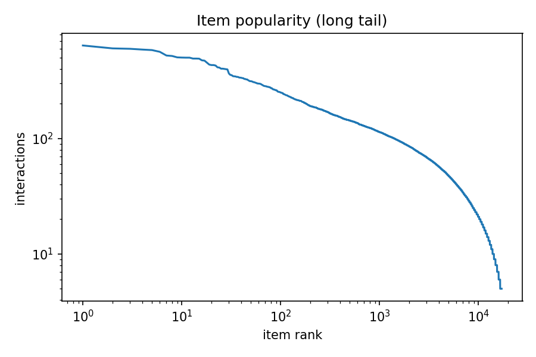
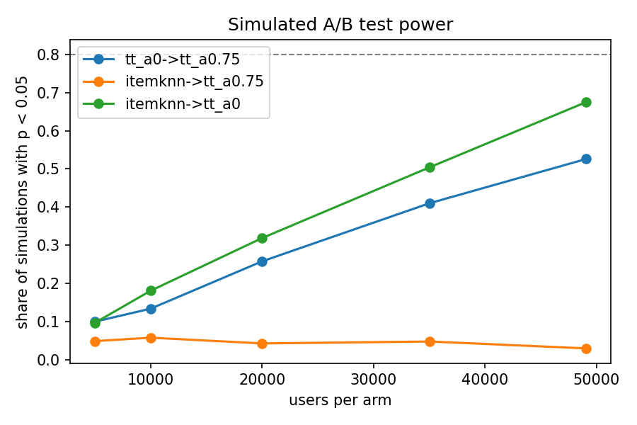
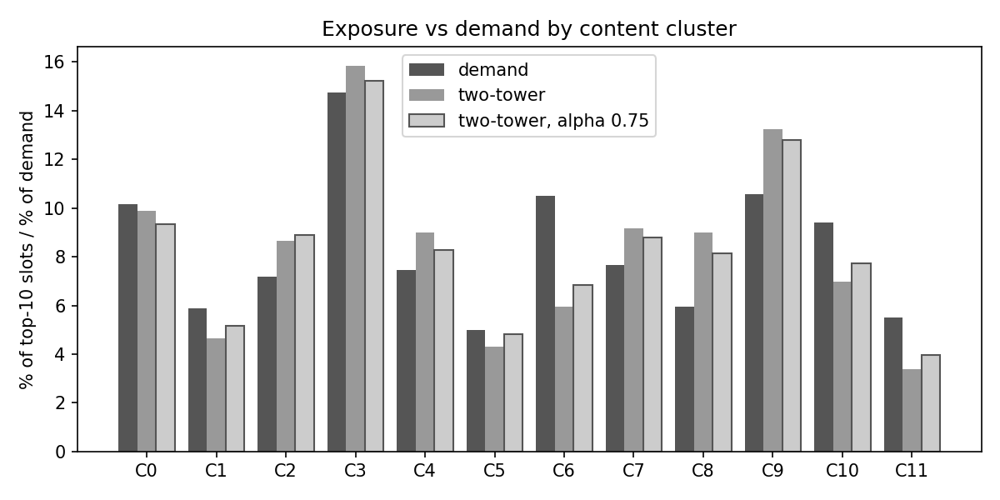

# VidRec-Lens

Content-aware short-video recommendation on MicroLens-100K, with bias-aware offline evaluation, a simulated A/B test, content-cluster analysis and a small prediction API.

The model is a two-tower network that combines a learned ID embedding with cover-image, title and video features. It is compared against popularity and item-kNN baselines under a leave-last-out protocol with full ranking over the whole catalogue (17,228 videos, 98,129 users, 705,174 interactions after 5-core filtering).

## Headline results

Test split, each user's last interaction, history = everything before it. Random Recall@10 is 0.0006.

| Model | Recall@10 | NDCG@10 | Recall@50 | Tail Recall@10 | Coverage@10 |
|---|---|---|---|---|---|
| Popularity | 0.0029 | 0.0014 | 0.0123 | 0.0000 | - |
| Item-kNN | 0.0586 | 0.0305 | 0.1364 | 0.0476 | 0.980 |
| Two-tower hybrid | 0.0551 | 0.0268 | 0.1513 | 0.0321 | 0.789 |
| Two-tower hybrid + popularity adjustment (alpha 0.75) | 0.0581 | 0.0283 | 0.1523 | 0.0460 | 0.966 |

The two-tower rows are refit on train+val so they see the same data as item-kNN. Tail = the 80% of videos that are not in the top 20% by training popularity.

What these numbers support:

- The popularity adjustment raises hit@10 by +0.0029 (95% CI +0.0019 to +0.0039, paired over the same 98,129 users) and raises tail recall from 0.0321 to 0.0460 and catalogue coverage from 79% to 97%.
- The adjusted two-tower is statistically indistinguishable from item-kNN on hit@10 (difference -0.0005, CI -0.0019 to +0.0009), better at Recall@50 (0.1523 vs 0.1364), and worse on NDCG@10 (-0.0022, CI -0.0030 to -0.0015).

## Modality ablation (train-only models, test Recall@10)

| ID embedding only | Content only (cover + title + CLIP RN50) | Hybrid, 3 modalities | Hybrid, 4 modalities (+ VideoMAE) |
|---|---|---|---|
| 0.0375 | 0.0370 | 0.0439 | 0.0442 |

Content and IDs are complementary (+17 to 19% over either alone). Adding VideoMAE features changes Recall@10 by 0.0003 on test and 0.0010 on validation, which is within noise for a single seed. These models are trained on train only, so compare them with each other, not with the table above.

## Evaluation framework

- Temporal leave-last-out split per user (last = test, second last = validation), full ranking, tie-aware ranks, Recall/NDCG at 10 and 50, head/tail slices.
- Paired comparisons with 95% intervals over the same users.
- Simulated A/B test: users split at random into two arms, 1,000 simulations per arm size. A true +5.3% lift is detected only 53% of the time with all users split 49,064 per arm. About 96,600 users per arm would be needed for 80% power. The paired comparison on the same users has about 8 times more statistical power than the split test.
- Segment slices: by history length and by how many past interactions the target video had. The popularity adjustment roughly doubles hit rate on rarely seen videos (1-4 past interactions: 0.0090 to 0.0193) at the cost of the most popular ones (100+: 0.1360 to 0.1075). Item-kNN is significantly better on rarely seen videos (0.0332).
- Not done: counterfactual estimators (IPS, doubly robust). MicroLens does not log the probability with which each video was shown.

## Content clusters

Videos are grouped into 12 clusters (KMeans on a PCA of cover, title and CLIP RN50 embeddings) and exposure is compared with what users actually watch next. The popularity adjustment moves the distance between exposure and demand from 0.113 to 0.086 (item-kNN 0.086) and the distance from catalogue share from 0.195 to 0.167 (item-kNN 0.086). About two thirds of the overall hit@10 gain comes from one cluster, C3, which looks like mobile-game clips. Cluster names in `reports/day7_clusters.json` come from distinctive title words; the optional LLM-suggested names are unreliable (see limitations).

## Repository layout

```
src/vidreclens/   data/ features/ models/ eval/ serve/
scripts/          day1..day7 pipeline steps, export_bundle.py
tests/            data and serving tests
reports/          metrics (json) and plots
notebooks/        vidreclens_pipeline.ipynb (runs everything on Kaggle)
Dockerfile        API image (numpy + FastAPI only)
```

## Reproduce

The whole pipeline runs in one Kaggle notebook (GPU T4, internet on): `notebooks/vidreclens_pipeline.ipynb`, Save Version, Save & Run All. It downloads MicroLens-100K, builds embeddings, trains and evaluates every model, runs the analyses, exports the serving bundle and runs the tests (about 75 minutes). Training is deterministic: repeated runs reproduced the same losses and metrics.

The dataset is not included. MicroLens restricts redistribution; download it from the authors' site.

## Serve

`scripts/export_bundle.py` turns the trained model into a small numpy-only bundle (precomputed item vectors, user-network weights, popularity penalty, titles), so the API does not need PyTorch. A test checks that the numpy engine returns the same top-10 and scores as the PyTorch model.

```
docker build -t vidreclens .
docker run -p 8000:8000 vidreclens

curl -X POST localhost:8000/recommend -H 'Content-Type: application/json' \
  -d '{"history": [101, 205, 3140], "k": 5, "alpha": 0.75}'
```

`history` is a list of MicroLens video ids, oldest first. Unknown ids are reported back, an empty history falls back to the most popular videos, and `alpha` (0 to 2) sets the popularity penalty. Other endpoints: `GET /health`, `GET /items/{id}`.

Without Docker: `pip install -e ".[serve]"` then `VIDRECLENS_BUNDLE=bundle uvicorn --factory vidreclens.serve.app:create_app`.

## Limitations

- One seed, one dataset, one model family. Differences below about 0.001 in Recall@10 are within noise.
- The target is each user's last item only, and hit rate is not a click-through rate. Offline gains may not carry over to a live system.
- MicroLens has implicit interactions only (no watch time), and videos with fewer than 5 interactions were removed, so cold-start behaviour cannot be demonstrated: only 177 test users have a target video with no past interactions, and no policy hit any of them.
- The refit uses a fixed 22 epochs chosen on validation.
- The optional LLM step (Qwen2.5-1.5B-Instruct) names clusters poorly in 3 of 12 cases and its rewritten summary contains wording errors even when its automatic number check passes. Treat the computed findings as the source of truth.
- VideoMAE features are only weakly related to cover, title and CLIP features (rank correlation 0.00 to 0.03).

## Plots





## Notes on reproducibility

`reports/` holds the outputs of the final end-to-end run (bias sweep, A/B simulation, clusters, plots). The baseline and modality-ablation tables above come from earlier runs of the same code (`scripts/day3_baselines.py` and `scripts/day4_twotower.py`). To regenerate their JSON files, set `RUN_BASELINES = True` and `RUN_TWOTOWER = True` in the notebook (about an extra hour).

## Status

The API was tested with uvicorn on macOS (health and recommend endpoints). The Dockerfile has not been built or run yet.
